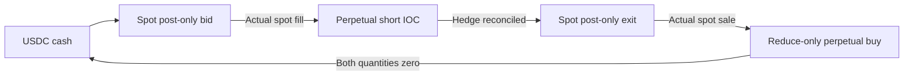

# BTC cycle accounting and recovery

The pilot has one owner of trading state. Public-data callbacks update a cache or queue. They never place orders or change the position ledger. The runner passes observations to `Engine`, persists each decision, and sends at most one unresolved command through the venue adapter.

This design makes order ownership explicit when an acknowledgement is lost. Account snapshots remain a mandatory check against the local ledger, but a snapshot alone cannot explain whether a balance change came from a known fill, an external transfer, or an unresolved order.

## One cycle starts from cash

The strategy starts without BTC inventory. Its initial maker order is a spot bid. The default target is 100 bp below the quantity-weighted price at which the intended BTC perpetual hedge could be sold. The spot price must also remain post-only.

After a spot fill, the engine updates the net received BTC quantity, including any fee charged in BTC. It sells a corresponding perpetual quantity through a price-limited IOC order. Partial hedge fills leave an explicit residual. The engine does not infer a fill from an acknowledgement or count a repeated fill twice.

Once the entry is hedged, the engine cancels any remaining entry bid and posts one spot offer. The offer price includes paid costs, the current estimated hedge-cover cost, expected exit fees, and the configured profit target. When spot sells, the corresponding perpetual buy is reduce-only. The next entry begins only after the cycle is complete.



The 500 USDC capital setting is a pilot budget, not one order's size. Defaults use approximately 20 USDC per entry and cap spot inventory at 100 USDC. Rounding can make an entry smaller. The engine also reserves collateral for the prospective hedge before placing a bid.

## Exit prices use the whole remaining cycle

`cycle_cashflow` records cash flows from recognized fills, paid quote-currency fees, and recognized funding. Perpetual trade cash flows are a bookkeeping device for the hedged cycle. They are not spendable proceeds from opening a short.

For remaining spot quantity `q_s`, short quantity to cover `q_p`, cover VWAP `F`, paid net cash flow `C`, and target `T`, the minimum spot exit price is:

```text
P = [q_p × F × (1 + perp_taker_fee) + T − C]
    / [q_s × (1 − spot_maker_fee)]
```

The default `T` is the entry notional multiplied by 55 bp: `minimum_profit_bp=50` plus `execution_reserve_bp=5`. The price is rounded upward to a permitted spot price. This is a quote condition, not a promised realized return. The hedge-cover price can change before the spot exit fills.

The fee defaults are planning inputs: `spot_maker_fee=0.0004` and `perp_taker_fee=0.00045`. They do not query or guarantee the account's effective fee tier. Live fill records supply actual paid fees. Live funding records enter the ledger when observed. Hyperliquid settles perpetual funding hourly; the paper adapter currently omits these payments. See [Hyperliquid funding](https://hyperliquid.gitbook.io/hyperliquid-docs/trading/funding).

## Local state and exchange state must agree

`EngineState` contains owned order intents, the pending command, exchange-order mappings, fill and funding identifiers, quantities, cycle accounting, and risk anchors. Client order IDs derive from a persisted instance identifier and increasing sequence.

`Store` uses a process lock and SQLite with write-ahead logging and `synchronous=FULL`. The state checkpoint and event row are saved in one transaction. A checksum guards the serialized checkpoint. This is a durable checkpoint with an event record, not a claim that every exchange event can be reconstructed from the event table alone.

The runner persists a pending command before its network effect. A response updates that same pending command. An unknown result remains unresolved. Recovery queries the existing order identity and ingests recognized fills before allowing further actions. Missing order information is not proof that the exchange rejected an order.

Account reconciliation compares the ledger's quantities with exchange balances and positions. Foreign activity, an unexplained position difference, or an unrecognized fill prevents new trading. A new state directory is not a recovery mechanism for an existing live position.

The live adapter requires a dedicated classic account because this pilot does not attribute shared-account activity among multiple strategies. It checks the UBTC token identity and USDC quote identity, then discovers precision from metadata. The configured spot identifier is not accepted as sufficient proof of asset identity.

## Precision and residual quantities

All strategy prices, quantities, and cash calculations use `Decimal`. Quantity limits come from each market's `szDecimals`. Price rounding follows the significant-figure and decimal limits for the market. Hyperliquid permits integer prices regardless of significant-figure count. See [tick and lot size](https://hyperliquid.gitbook.io/hyperliquid-docs/for-developers/api/tick-and-lot-size).

The pilot enforces a 10 USDC minimum order amount and does not assume that reduce-only orders are exempt. A small partial fill or BTC-denominated fee can leave a residual below the minimum or below a permissible quantity increment.

`dust_wait_ms=10000` allows a short accumulation window for an outstanding residual that the engine can detect at perpetual quantity precision. The existing maker remainder can remain during that window. A residual that cannot be hedged causes a halt when its timer expires. Smaller rounding residuals stay visible in the ledger and must not be described as fully hedged or silently discarded.

## Safety stops preserve the evidence

The default book-age limit is two seconds, the maximum unhedged exposure is 25 USDC, and the holding limit is one hour. The unhedged limit leaves room above a 20 USDC entry for bid/ask differences and price changes. Three successive hedge rejections halt further hedge attempts. Equity controls use observed account equity and persist their anchors across restart.

A halt blocks new entries and requests cancellation of owned makers. The engine can still attempt an eligible residual hedge when market data and reconciliation permit. It does not automatically flatten every position or remove an existing hedge. Price gaps, unavailable depth, rejected actions, or a disconnected process can cause losses beyond a configured threshold.

The live adapter schedules an exchange cancel-all deadline 90 seconds ahead and refreshes it every 30 seconds. This is an open-order control, not a position close. It is account-wide, which is another reason to use a dedicated account. The exchange also limits scheduled-cancel triggers per UTC day. See [the exchange endpoint](https://hyperliquid.gitbook.io/hyperliquid-docs/for-developers/api/exchange-endpoint).

## Paper and live share decisions, not execution evidence

Both adapters expose snapshots, submission results, and order resolution to the same engine. `PaperVenue` starts with 250 simulated USDC in each cash compartment and applies configured fees. The live adapter reads the actual account and uses the official SDK to sign approved actions.

The public feed requests fast L2 books, which expose five levels, and spot trades. Missing deeper liquidity is treated as unavailable for the contemplated hedge. The paper adapter fills only after a modeled 200 ms arrival delay and a strict trade-through. Its 10% participation assumption is deliberately limited, but it is not a validated queue model. Public data cannot establish whether a real resting order would have that priority.

The simulation does not validate funding costs, live transport delays, exchange matching, liquidation behavior, or recovery after every possible network failure. Meaningful local tests check decision boundaries and recovery cases. They are separate from evidence of profitable trading.
